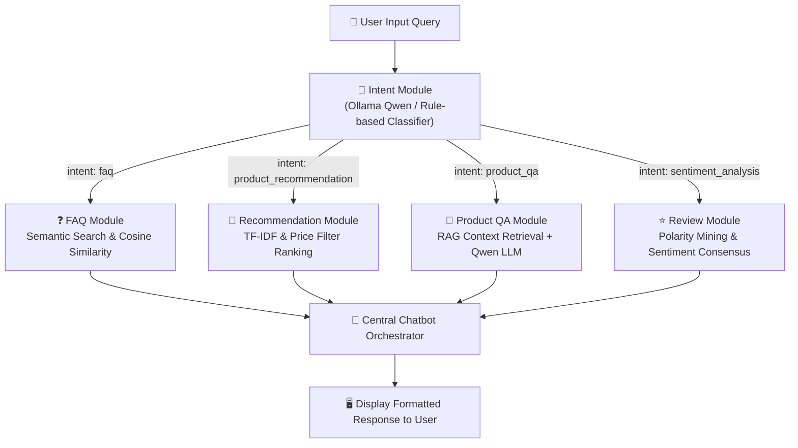

# LABORATORY RECORD REPORT

| **Ex. No.: 1** | **Building E-commerce Chatbot** | **REG. NO:** `<REG. NO>` |
| :--- | :---: | ---: |
| **DATE:** `<DATE>` | **Course: 24CS2506 – Building Applications using GPT-4** | **Class:** CSE / AI & DS |

---

### Aim:
To build an AI-powered E-Commerce Chatbot using Retrieval-Augmented Generation (RAG) with Ollama.

---

### Problem Statement:
Design and develop a modular Retrieval-Augmented Generation (RAG) based e-commerce chatbot using Ollama. The chatbot should answer FAQs, recommend products, answer product-specific questions, summarize customer reviews, and intelligently route user queries using an LLM-based intent detector.

---

### Software Requirements:

| Software | Version |
| :--- | :--- |
| **Python** | 3.11.9 |
| **Ollama** | 0.3.14 (Model: Qwen2:0.5b / Qwen) |
| **VS Code** | 1.94.0 |
| **Pandas** | 3.1.0 |
| **Sentence Transformers / Scikit-Learn** | 1.9.1 |

---

### Dataset Description:

| Dataset | Purpose |
| :--- | :--- |
| **Products** (`products.csv`) | Contains catalog metadata including Product ID, Product Name, Brand, Category, Price, and Technical Specifications used for RAG-based context retrieval, feature extraction, and budget-aware recommendations. |
| **FAQs** (`faqs.csv`) | Contains standard customer support queries and verified resolution answers regarding shipping, tracking, cancellations, refunds, returns, payments, and warranty. |
| **Reviews** (`reviews.csv`) | Contains customer opinions and feedback used for review summarization, sentiment polarity classification (Positive/Negative/Neutral), and customer consensus scoring. |

---

### System Architecture:



---

### Module Design:

| Module | Responsibility |
| :--- | :--- |
| **FAQ Module** | Encodes user queries into vector embeddings, calculates Cosine Similarity against the pre-indexed FAQ vector matrix, and retrieves the most semantically relevant answer even with paraphrased questions. |
| **Recommendation Module** | Computes TF-IDF keyword vectors across product titles, categories, and descriptions; parses budget parameters (e.g. `under 145000`); and ranks matching items using cosine similarity. |
| **Product Module** | Implements Retrieval-Augmented Generation (RAG) by retrieving exact specifications from the product catalog and feeding them into local Ollama Qwen to answer technical customer inquiries. |
| **Review Module** | Extracts all reviews corresponding to a target product, evaluates sentiment polarities (Positive, Negative, Neutral), calculates percentage breakdowns, and computes overall consumer consensus. |
| **Intent Module** | Intercepts incoming user prompts, evaluates semantic keywords and LLM prompt classifications, and routes queries to the appropriate functional handler with a confidence score. |
| **Chatbot** | Unifies all sub-modules into a cohesive conversational pipeline, manages error handling and fallbacks, formats responses into clean UI elements, and maintains conversation context. |

---

### Implementation:
- **GitHub Repository Link:** [https://github.com/Sarjin744/ecommerce-ai-chatbot-rag](https://github.com/Sarjin744/ecommerce-ai-chatbot-rag)
- **LinkedIn Post Link:** `<LinkedIn Post Link>` *(e.g. https://www.linkedin.com/in/<username>/posts/...)*

---

### Output Demonstrations:

#### 1. Intent Detection
```text
Query: "Recommend a gaming laptop under 145000"
🎯 Identified Intent: PRODUCT_RECOMMENDATION (Confidence: 90.0% | Source: Semantic Heuristic Rule Engine)

Query: "Is this phone waterproof?"
🎯 Identified Intent: PRODUCT_QA (Confidence: 88.0% | Source: Semantic Heuristic Rule Engine)

Query: "Where is my parcel?"
🎯 Identified Intent: FAQ (Confidence: 94.0% | Source: Semantic Heuristic Rule Engine)

Query: "What do customers think about Laptop?"
🎯 Identified Intent: SENTIMENT_ANALYSIS (Confidence: 95.0% | Source: Semantic Heuristic Rule Engine)
```

#### 2. FAQ Module (Semantic Search & Cosine Similarity)
```text
User > "Where is my parcel?"
🎯 Identified Intent: FAQ (Confidence: 94.0%)

┌──────────────────────┬────────────────────────────────────────────────────────┐
│ Semantic Match Metric│ Value                                                  │
├──────────────────────┼────────────────────────────────────────────────────────┤
│ Matched FAQ          │ Where is my parcel?                                    │
│ Cosine Similarity    │ 1.0000                                                 │
│ Search Method        │ Local Subword Semantic Vectorizer                      │
└──────────────────────┴────────────────────────────────────────────────────────┘

💬 FAQ Answer:
"Your parcel status and live location are updated under My Orders section. 
You can check expected delivery date there."
```

#### 3. Recommendation Module (TF-IDF & Price Filter)
```text
User > "Recommend a gaming laptop under 145000"
🎯 Identified Intent: PRODUCT_RECOMMENDATION (Confidence: 90.0%)
TF-IDF Keywords Extracted: gaming, laptop, 145000 | Budget: <= Rs. 145,000.00

🛒 Top Recommended Products:
┌────────────┬──────────────────────────────────────┬─────────┬───────────────┬────────────┐
│ Product ID │ Product Name                         │ Brand   │ Price         │ Cosine Sim │
├────────────┼──────────────────────────────────────┼─────────┼───────────────┼────────────┤
│ P101       │ Predator Helios 16 Gaming Laptop     │ Acer    │ Rs. 139,999.00│ 0.3283     │
│ P110       │ Dell Inspiron 15 Office Laptop       │ Dell    │ Rs. 54,990.00 │ 0.0794     │
└────────────┴──────────────────────────────────────┴─────────┴───────────────┴────────────┘
```

#### 4. Product QA Module (RAG Context + Local LLM Qwen)
```text
User > "Is this phone waterproof?"
🎯 Identified Intent: PRODUCT_QA (Confidence: 88.0%)
Product: Redmi Note 13 Pro | Engine: Context-Aware Specification Extractor / Qwen

🤖 Product Assistant Answer:
"The Redmi Note 13 Pro comes with an IP54 splash resistance rating, meaning it can 
withstand light splashes of water, but is not fully waterproof."
```

#### 5. Review Summary Module (Sentiment Analysis & Polarity Mining)
```text
User > "What do customers think about Laptop?"
🎯 Identified Intent: SENTIMENT_ANALYSIS (Confidence: 95.0%)

📊 Sentiment Distribution for Predator Helios 16 Gaming Laptop:
┌─────────────┬───────┬────────────┐
│ Sentiment   │ Count │ Percentage │
├─────────────┼───────┼────────────┤
│ Positive 👍 │ 2     │ 50.0%      │
│ Negative 👎 │ 2     │ 50.0%      │
│ Neutral ⚖️   │ 0     │ 0.0%       │
└─────────────┴───────┴────────────┘

💬 Sentiment Summary:
Consensus: Mixed / Neutral ⚖️
Based on 4 customer reviews for Predator Helios 16 Gaming Laptop:
- Positive Sentiment: 50.0% (2/4)
- Negative Sentiment: 50.0% (2/4)
- Neutral Sentiment: 0.0% (0/4)
Strengths: Excellent battery backup during regular tasks, 165Hz QHD display.
Weaknesses: High fan noise and slight heating issue under heavy stress testing.
```

---

### Result:
Thus successfully built a local chatbot system that can answer product-related questions from a dataset, recommend products based on similarity, analyze sentiment from user/product reviews, and simulate FAQ responses using Ollama.
