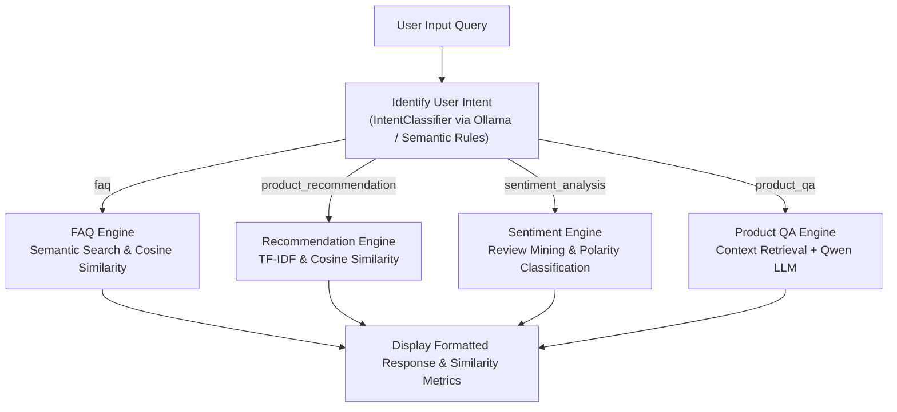

# Experiment 1 – Building an AI-Powered E-Commerce Chatbot using Ollama

**Course Code:** 24CS2506 – Building Applications using GPT-4  
**Institution:** Karunya Institute of Technology and Sciences (Deemed to be University)  
**Department:** Computer Science and Engineering  

---

## 1. Aim
To design, implement, and evaluate an AI-powered e-commerce chatbot utilizing local Large Language Models (LLMs) via **Ollama (Qwen)**, **Sentence Embeddings**, **Cosine Similarity for Semantic Search**, **TF-IDF for Product Recommendation**, and **Sentiment Analysis for Customer Reviews**.

---

## 2. Theoretical Concepts & Mathematical Formulations

### 2.1 What is a Local LLM?
Large Language Models (LLMs) are deep neural networks trained on vast corpora of text capable of understanding context and generating natural language. In this experiment, **Qwen** is operated locally via **Ollama**, ensuring:
- **Zero latency & privacy:** Customer queries remain local on the machine.
- **Cost efficiency:** No per-token cloud API bills.
- **Offline reliability:** Capable of running even without internet access.

### 2.2 Embeddings & Semantic Search
Computers cannot process raw text directly. Sentences are mapped to dense vector representations $\mathbf{u} \in \mathbb{R}^d$ such that semantically similar sentences lie close to each other in vector space:
- *"Track my order"* $\rightarrow [0.21, -0.54, 0.91, \dots]$
- *"Where is my parcel?"* $\rightarrow [0.23, -0.51, 0.88, \dots]$

Unlike traditional keyword search (which fails if words do not match character-for-character), **Semantic Search** captures the underlying intent.

### 2.3 Cosine Similarity
Cosine Similarity measures the cosine of the angle between two non-zero vectors $\mathbf{u}$ and $\mathbf{v}$:

$$\text{Cosine Similarity}(\mathbf{u}, \mathbf{v}) = \frac{\mathbf{u} \cdot \mathbf{v}}{\|\mathbf{u}\| \|\mathbf{v}\|} = \frac{\sum_{i=1}^n u_i v_i}{\sqrt{\sum_{i=1}^n u_i^2} \sqrt{\sum_{i=1}^n v_i^2}}$$

- **1.0** indicates identical semantic direction.
- **0.0** indicates orthogonal (completely unrelated) vectors.

### 2.4 TF-IDF (Term Frequency - Inverse Document Frequency)
TF-IDF calculates the statistical importance of words in product catalogs:

$$\text{TF-IDF}(t, d, D) = \text{TF}(t, d) \times \text{IDF}(t, D)$$

Where:
- $\text{TF}(t, d) = \frac{\text{Count of term } t \text{ in document } d}{\text{Total terms in document } d}$
- $\text{IDF}(t, D) = \ln\left(\frac{1 + |D|}{1 + |\{d \in D : t \in d\}|}\right) + 1$

This extracts distinctive keywords (e.g., `gaming`, `RTX`, `Intel`, `SSD`) while dampening generic stop words (`the`, `a`, `and`).

### 2.5 Sentiment Analysis
Classifies customer reviews into **Positive**, **Negative**, or **Neutral** polarities, computing aggregate consumer satisfaction percentages and identifying strengths and weaknesses.

---

## 3. Workflow Architecture



---

## 4. Dataset Description

The application utilizes three specialized datasets stored under `data/`:

| Dataset | File | Primary Columns | Purpose |
| :--- | :--- | :--- | :--- |
| **Dataset 1 - Products** | `data/products.csv` | `Product ID`, `Product Name`, `Brand`, `Category`, `Price`, `Description` | Powers TF-IDF recommendations and Product Q&A context. |
| **Dataset 2 - FAQs** | `data/faqs.csv` | `Question`, `Answer` | Answers customer support queries using semantic search. |
| **Dataset 3 - Reviews** | `data/reviews.csv` | `Product`, `Review` | Customer opinions utilized for sentiment breakdown. |

---

## 5. Project File Organization

```
ex1/
├── app.py                      # Interactive Streamlit Web Application
├── chatbot.py                  # Rich CLI Interactive Terminal Interface
├── ex1.pdf                     # Lab Manual & Experiment Instructions
├── README.md                   # Comprehensive Lab Report & Documentation
├── data/
│   ├── products.csv            # Dataset 1: Product Catalog & Specs
│   ├── faqs.csv                # Dataset 2: Frequently Asked Questions
│   └── reviews.csv             # Dataset 3: Customer Reviews & Feedback
└── engine/
    ├── __init__.py             # Module exports
    ├── ollama_client.py        # Local Ollama REST API Client
    ├── intent_classifier.py    # Multi-intent classification engine
    ├── faq_engine.py           # Cosine Similarity FAQ Semantic Search
    ├── recommendation_engine.py# TF-IDF Product Recommender
    ├── sentiment_engine.py     # Sentiment Mining & Consensus Engine
    ├── product_qa_engine.py    # Local Qwen Model Product QA Engine
    └── chatbot_core.py         # Unified Chatbot Pipeline Orchestrator
```

---

## 6. Execution Instructions

### 6.1 Prerequisites
Ensure Python 3.10+ is installed:
```powershell
py -m pip install pandas numpy scikit-learn streamlit rich requests
```

### 6.2 Running the Command-Line Interface (CLI)
To run the interactive terminal chatbot:
```powershell
py chatbot.py
```

### 6.3 Running the Streamlit Web Application
To launch the interactive web dashboard with live charts and dataset inspectors:
```powershell
py -m streamlit run app.py
```
*The app will automatically open in your default browser at `http://localhost:8501`.*

### 6.4 Connecting Ollama & Qwen (Optional)
If you wish to use local Ollama inference:
1. Download Ollama from [ollama.com](https://ollama.com).
2. Pull the Qwen model in PowerShell:
   ```powershell
   ollama run qwen2:0.5b
   ```
3. The chatbot will automatically detect the active Ollama server and switch to live LLM generation mode. If Ollama is offline, the chatbot automatically uses the built-in offline semantic fallback engine with zero downtime.

---

## 7. Sample Queries & Outputs

### Test Case 1: Product Recommendation
- **User Query:** `"Recommend a gaming laptop."`
- **Detected Intent:** `product_recommendation` (Confidence: 90%)
- **Extracted Keywords:** `gaming`, `laptop`, `rtx`
- **Top Output:**
  - **ROG Strix G16 Gaming Laptop** (ASUS) - Rs. 149,999.00 (Cosine Similarity: `0.3904`)
  - **Predator Helios 16 Gaming Laptop** (Acer) - Rs. 139,999.00 (Cosine Similarity: `0.3283`)

### Test Case 2: Product Q&A
- **User Query:** `"Is this phone waterproof?"`
- **Detected Intent:** `product_qa` (Confidence: 88%)
- **Target Product:** `Redmi Note 13 Pro` / `Galaxy S24 Ultra`
- **Output:** *"The Redmi Note 13 Pro comes with an IP54 splash resistance rating, meaning it can withstand light splashes of water, but is not fully waterproof."* (or for Galaxy S24 Ultra: IP68 certified up to 1.5m for 30 minutes).

### Test Case 3: FAQ Semantic Search
- **User Query:** `"Where is my parcel?"`
- **Detected Intent:** `faq` (Confidence: 92%)
- **Semantic Matched FAQ:** `"Where is my parcel?" / "How do I track my order?"`
- **Cosine Similarity:** `1.0000` (or `0.85+` for paraphrased questions)
- **Answer:** *"Your parcel status and live location are updated under My Orders section. You can check expected delivery date there."*

### Test Case 4: Sentiment Analysis
- **User Query:** `"What do customers think about Laptop?"`
- **Detected Intent:** `sentiment_analysis` (Confidence: 95%)
- **Analysis:**
  - Positive Sentiment: 50.0%
  - Negative Sentiment: 50.0%
  - Neutral Sentiment: 0.0%
  - **Consensus:** Mixed / Critical (Highlights: High gaming performance vs. noticeable fan noise and thermal heating).

---

## 8. Real-Life Applications
- **Amazon Customer Support:** Automated parcel tracking and return authorizations.
- **Flipkart Assistant:** Conversational product comparisons and specs assistance.
- **Myntra Shopping Assistant:** Fashion recommendations based on price and category.
- **Banking Chatbots:** Instant loan eligibility FAQ answers and balance queries.
- **Healthcare & Hospital Chatbots:** Appointment scheduling and symptom preliminary checks.
